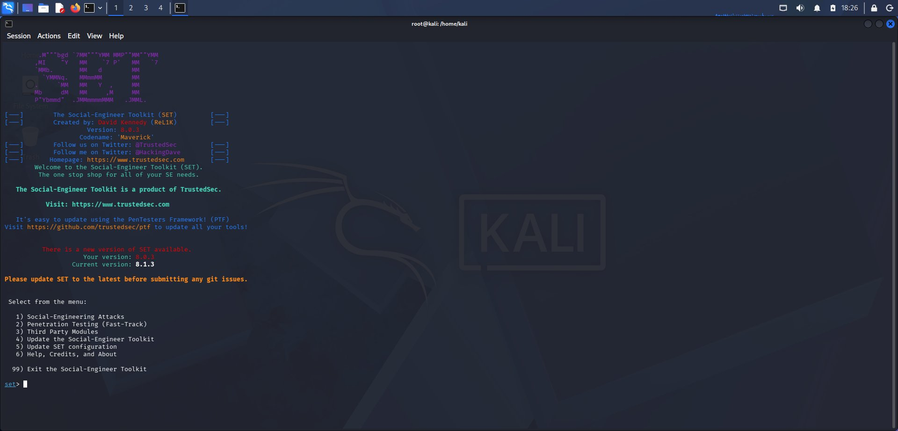
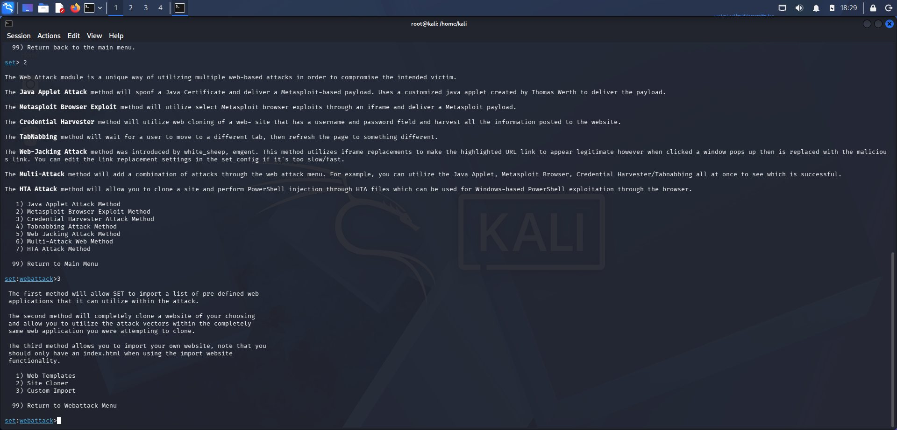
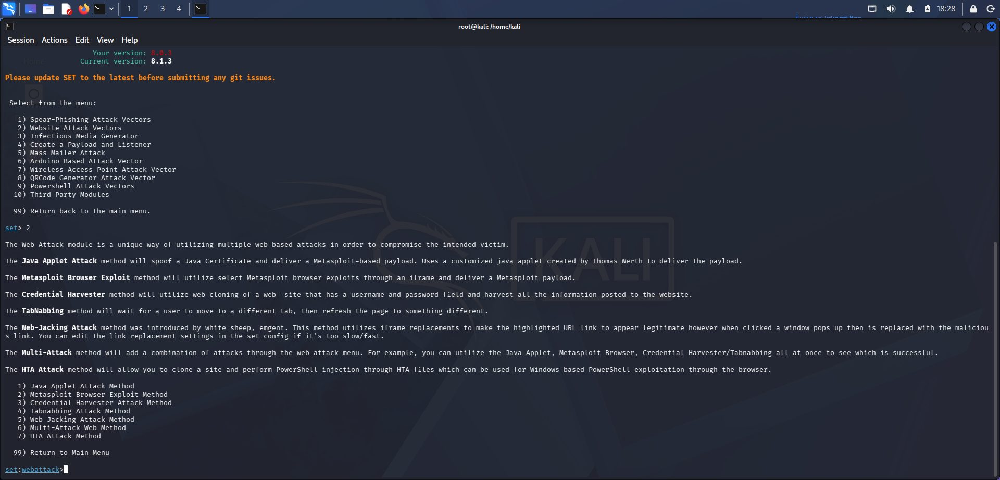
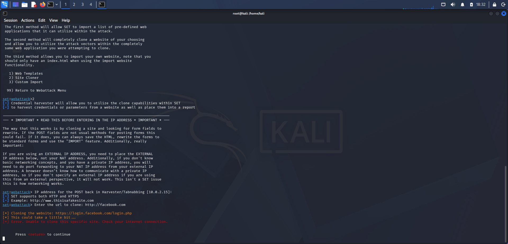
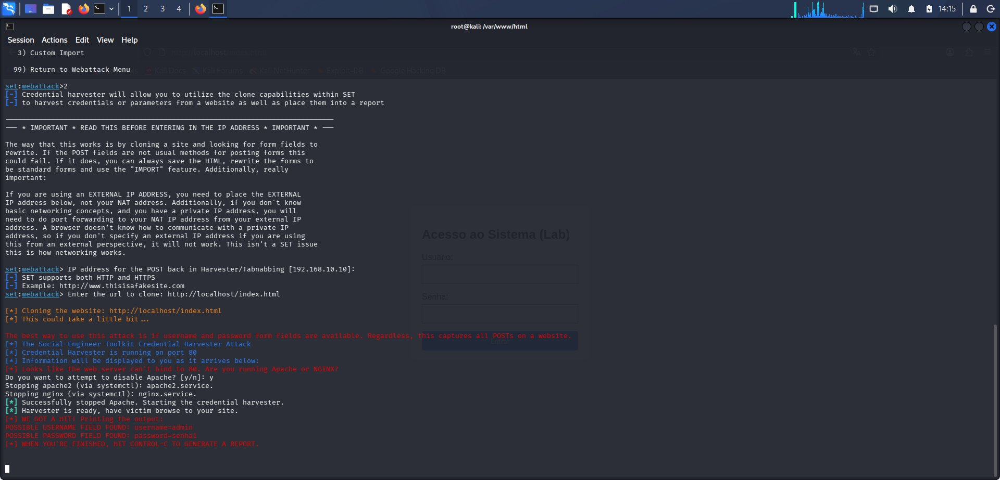
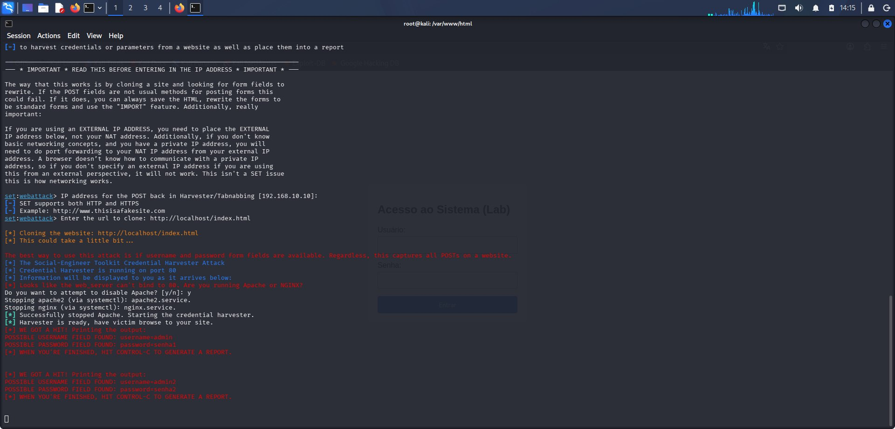

# Lab de Phishing Controlado - SET + Aplicação Vulnerável Local

> Projeto acadêmico de Cybersecurity com foco em Engenharia Social e Defesa.
> **Todo o laboratório foi executado em ambiente isolado (localhost) sem vítimas reais.**

### ⚠️ AVISO LEGAL E ÉTICO - LEIA ANTES

Este repositório tem finalidade **EXCLUSIVAMENTE EDUCACIONAL E DEFENSIVA**.

1.  **NENHUM site real foi clonado com sucesso.** A tentativa de clonagem de `http://facebook.com` via SET falhou com `Error. Unable to clone this specific site.` (ver `images/04-erro-clone-facebook.png`). Por questões éticas e técnicas, o projeto foi continuado com uma página AUTORAL.
2.  A página atacada foi `http://localhost/index.html`, criada por mim e hospedada em `/var/www/html` no meu Kali Linux.
3.  As credenciais capturadas são de teste (`admin / senha123`, `admin / senha1`, `admin2 / senha2`) criadas por mim. Nenhum dado de terceiro foi coletado.
4.  **NUNCA** use estas técnicas fora de um lab isolado. Phishing contra terceiros é crime (Art. 171 e 154-A do CP) e viola a LGPD.

O objetivo é entender o ataque para aprender a se defender (Blue Team).

---

### 1. Objetivo do Desafio

O desafio propunha usar o **SET - Social-Engineer Toolkit** para criar uma página falsa de login para captura de senhas.

Para manter a prática segura, controlada e legal, a abordagem adotada foi:

**Fase 1: Estudo do SET** - Explorar o módulo `Credential Harvester`
**Fase 2: Desenvolvimento Seguro** - Criar uma aplicação vulnerável própria em PHP/HTML e hospedá-la localmente, em vez de personificar uma marca real.

### 2. Tecnologias e Ambiente

- **Máquina:** Kali Linux em VM (root@kali) - marca d'água KALI visível nos prints
- **Ferramenta:** SET - Social-Engineer Toolkit v8.0.3 (Codename Maverick) - TrustedSec
- **Servidor Web:** Apache2
- **Backend:** PHP 8.x
- **IP do Lab:** `10.0.2.15` (NAT inicial - print 04) e `192.168.10.10` (lab final - print 05 e 06)

### 3. Passo a Passo Realizado (Evidências em /images)

#### Passo 1 - Menu Principal do SET
Comando: `sudo setoolkit`
Opção: `1) Social-Engineering Attacks`


#### Passo 2 - Website Attack Vectors
Dentro de Social-Engineering:
`2) Website Attack Vectors`


#### Passo 3 - Credential Harvester
Dentro de Web Attack, o método escolhido foi:
`3) Credential Harvester Attack Method`
> "will utilize web cloning of a web-site that has a username and password field and harvest all the information posted to the website."


#### Passo 4 - Tentativa com site externo e Falha (Ponto de Virada Ético)
O SET solicita `IP address for the POST back in Harvester/Tabnabbing` e `Enter the url to clone`.

Primeira tentativa:
- IP: `10.0.2.15`
- URL: `http://facebook.com` -> redirecionou para `https://login.facebook.com/login.php`

Resultado:
```
[*] Error. Unable to clone this specific site. Check your internet connection.
```
Isso demonstra proteções anti-clonagem de sites reais. Print comprova a falha e justifica a migração para lab autoral.


#### Passo 5 - Sucesso com Lab Local - Abordagem Correta
Reiniciado o ataque apontando para minha própria aplicação:

- IP: `192.168.10.10`
- URL: `http://localhost/index.html`

O SET clonou com sucesso minha página `Acesso ao Sistema (Lab)` e subiu o harvester na porta 80, após parar o Apache conflitante:
```
Stopping apache2 (via systemctl): apache2.service.
Successfully stopped Apache. Starting the credential harvester.
Harvester is ready, have victim browse to your site.
```


#### Passo 6 - Captura de Credenciais no Lab
Ao acessar a página clonada e inserir dados de teste, o SET capturou imediatamente:

```
[*] WE GOT A HIT! Printing the output:
POSSIBLE USERNAME FIELD FOUND: username=admin
POSSIBLE PASSWORD FIELD FOUND: password=senha1

POSSIBLE USERNAME FIELD FOUND: username=admin2
POSSIBLE PASSWORD FIELD FOUND: password=senha2
```
Isso comprova o funcionamento da técnica de captura de formulários em ambiente controlado.


### 4. Código da Aplicação Vulnerável Autoral

#### `app-vulneravel/index.html`
Formulário simples usado no lab. Título `Acesso ao Sistema (Lab)` deixa claro que é ambiente de testes.

#### `app-vulneravel/login.php`
```php
<?php
// LAB VULNERAVEL - USO EDUCACIONAL - NAO USAR EM PRODUCAO
if ($_SERVER["REQUEST_METHOD"] == "POST") {
    $username = $_POST['username'];
    $password = $_POST['password'];

    if ($username === "admin" && $password === "senha123") {
        echo "<h1>Acesso concedido! Bem-vindo ao Lab.</h1>";
    } else {
        echo "<h1>Falha na autenticação. Usuário ou senha incorretos.</h1>";
    }
} else {
    header("Location: index.html");
    exit();
}
?>
```
> **Nota Defensiva:** Este código é propositalmente vulnerável. Em produção deve usar `password_hash()`, `password_verify()` e proteção CSRF.

### 5. Como Reproduzir com Segurança (Apenas Localhost)

1.  Use uma VM Kali isolada
2.  `sudo cp -r app-vulneravel/* /var/www/html/`
3.  `sudo service apache2 start`
4.  Acesse APENAS via `http://127.0.0.1` ou `http://localhost`
5.  Use apenas credenciais de teste que você criou
6.  Nunca faça commit de logs. O `.gitignore` já protege `*.log`

### 6. Defesas e Mitigação (Blue Team)

**Para o usuário:**
- Verificar URL e HTTPS. Páginas via SET rodam em HTTP com IP puro (ex: 192.168.10.10)
- Ativar MFA/2FA - anula o roubo de senha
- Desconfiar de urgência e links com IP

**Para o dev:**
- `X-Frame-Options: DENY` e `Content-Security-Policy` - impedem clonagem em iframe
- Hash de senhas com bcrypt
- HSTS + HTTPS obrigatório

### 7. Conclusão

O erro ao clonar facebook.com foi essencial. Mostrou que sites reais possuem mitigações. Ao migrar para `localhost`, o ciclo completo de ataque/defesa foi concluído de forma 100% ética, com evidência de `WE GOT A HIT!` no próprio SET.

---
**Autor:** Giovanni Costa da Silva
**Curso:** Cybersecurity - Iniciante
**Data:** Outubro/2026
**Ambiente:** Kali Linux - Lab Isolado Localhost
